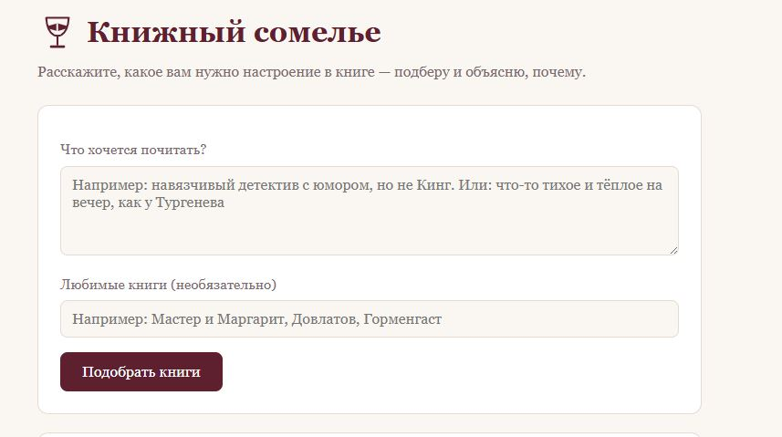
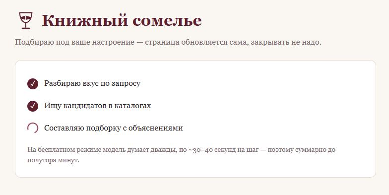
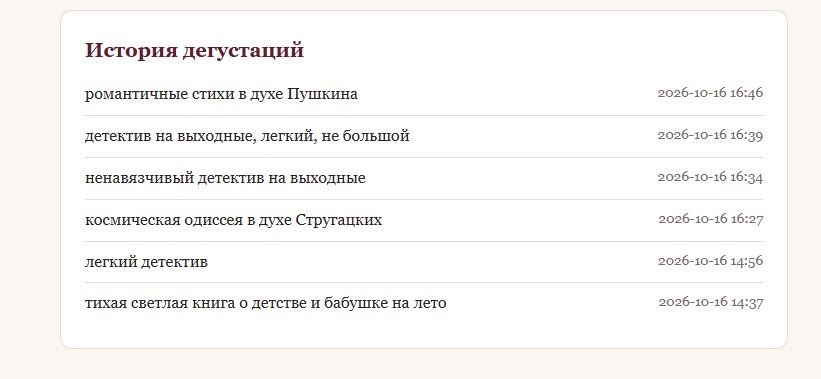
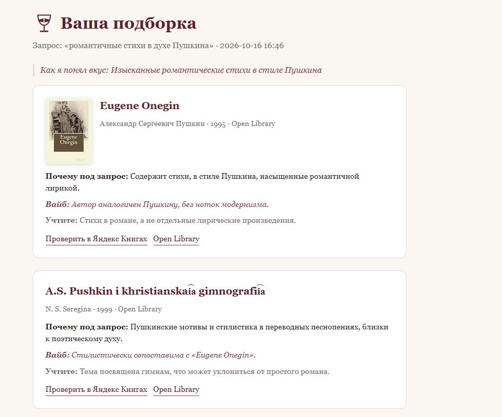
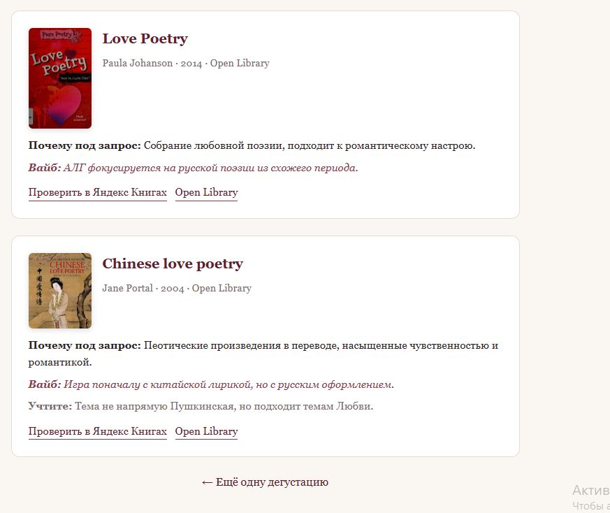

# 📚 Книжный сомелье

Веб-сервис, который подбирает книги под настроение. Вы описываете запрос
обычными словами — «навязчивый детектив с юмором, но не Кинг» — а ИИ-агент
разбирает запрос на признаки вкуса, ищет кандидатов в открытых каталогах
и возвращает подборку с объяснением, почему каждая книга подходит.

## Проблема

Выбрать следующую книгу под настроение — трудная задача: магазинные
алгоритмы советуют по популярности и покупкам, а не по «вайбу», и нигде
нельзя описать желание словами и получить живой список с обоснованием.

## Как работает

1. **Разбор вкуса** — модель превращает запрос в признаки: жанры, темы,
   настроения, анти-требования и поисковые ключевые слова.
2. **Поиск** — по этим признакам сервис собирает десятки кандидатов из
   открытых каталогов (Open Library, Google Books).
3. **Дегустация** — модель отбирает лучшее (3–5 книг) и для каждой
   объясняет: почему под запрос, на что похожа по вайбу, чем может
   не подойти.

Каждая рекомендация снабжена прямой ссылкой «Проверить в Яндекс Книгах» —
подписку на каталог этого сервиса через API получить нельзя, но
проверить наличие одним кликом просто. Подробности запроса сохраняются
в историю (SQLite): любую прошлую подборку можно открыть заново.

Языки: Open Library в основном англоязычный каталог, поэтому в
бесплатном режиме (где Google Books часто недоступен по общей квоте)
кандидаты в основном на английском. Русские переводы приходят из
Google Books с фильтром языка — они автоматически появляются в
подборке, когда этот источник доступен (ключ не обязателен, но
снимает квоту).

## Запуск

Нужен Python 3.10+ (Windows: используется лаунчер `py`).

```bash
py -m venv .venv
.venv\Scripts\pip install -r requirements.txt
.venv\Scripts\python app.py
```

Открыть в браузере: http://127.0.0.1:5000

Ключи API не обязательны — всё работает сразу:

- LLM — Pollinations, бесплатный режим: модель `openai-fast`, 1 запрос
  в 30 секунд (приложение соблюдает лимит само, подборка занимает
  около минуты);
- каталоги — Open Library и Google Books анонимно.

Опциональные улучшения (переменные окружения):

- `POLLINATIONS_API_KEY` — ключ [enter.pollinations.ai](https://enter.pollinations.ai/keys):
  без лимита частоты и с выбором моделей;
- `GOOGLE_BOOKS_API_KEY` — ключ Google Books: снимает общую дневную квоту
  анонимного доступа.

## Пользовательский сценарий

1. На главной странице опишите запрос (и, по желанию, любимые книги) →
   «Подобрать книги».
2. Откроется страница с живым прогрессом: три шага конвейера отмечаются
   по мере работы (✓ шаг пройден, крутится — выполняется). Не закрывайте
   страницу, пока крутится анимация: когда подборка готова, произойдёт
   автоматический переход к результату.
3. Карточки: обложка, обоснование, вайб, предупреждение и ссылки.
   Проверьте интересующую книгу в Яндекс Книгах по ссылке с карточки.
4. «← Ещё одну дегустацию» возвращает на главную; предыдущие подборки —
   в блоке «История дегустаций» и по прямой ссылке `/history/<id>`.

## Скриншоты

Шаг 1 — главная страница: описание запроса словами, опционально
любимые книги.



Шаг 2 — живой прогресс: три шага конвейера отмечаются по мере работы
(✓ пройден, крутится — выполняется).



Шаг 3 — итоговая подборка: карточки с обложкой, обоснованием «почему
под запрос», вайбом, предупреждением и ссылками («Проверить в Яндекс
Книгах», источник).



Ещё карточки той же подборки и ссылка на новую дегустацию:



История дегустаций: прошлые запросы с датами, любой можно открыть
заново по `/history/<id>`.



## Технологии

Python 3, Flask, HTML/CSS, SQLite; LLM через Pollinations
(OpenAI-совместимый endpoint), каталоги через Open Library Search API
и Google Books API.

## Структура

```
app.py                  Flask: маршруты /, /select, /history/<id>
config.py               настройки (модель, лимиты, параметры поиска)
sommelier/
  llm.py                обёртка над Pollinations (pacing, ретраи, JSON)
  taste.py              шаг 1: разбор запроса в признаки вкуса
  search.py             шаг 2: кандидаты из Open Library + Google Books
  curate.py             шаг 3: отбор подборки с обоснованиями
  db.py                 SQLite-история запросов
templates/              index, result, error
static/style.css        тёплая винная тема
```

## Ограничения бесплатного режима

- подборка занимает ~1 минуту (лимит Pollinations — 1 запрос в 30 сек,
  на дегустацию их две);
- модель `openai-fast` — компромисс по качеству текста; с ключом
  Pollinations можно выбрать модель посильнее в `config.py`;
- если Google Books упёрся в дневную квоту, подборка собирается только
  из Open Library (в основном англоязычные издания).